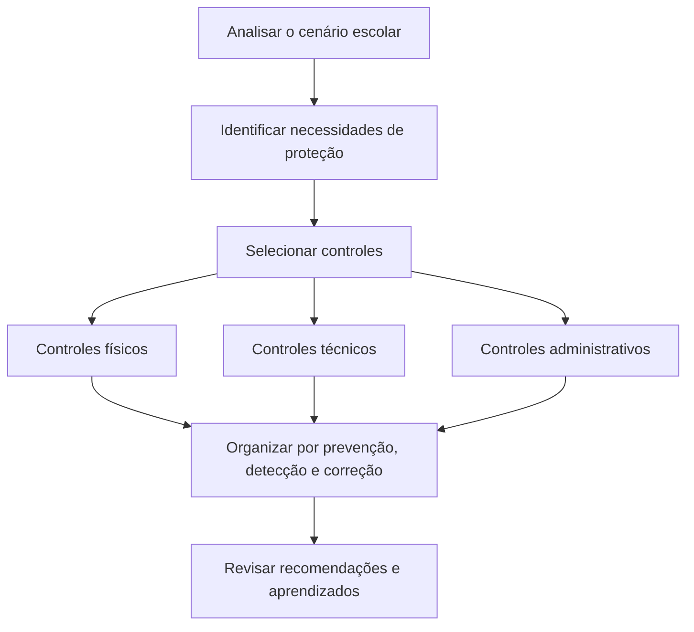

# Controles de segurança em um ambiente escolar

## Visão geral

Como proteger alunos, informações e equipamentos de uma escola? Neste laboratório da **Cisco Networking Academy (NetAcad)**, o objetivo é analisar as necessidades de uma rede escolar fictícia e recomendar medidas de proteção.

O estudo reúne **controles físicos, técnicos e administrativos**, organizados em três funções: prevenir problemas, identificar atividades suspeitas e recuperar o ambiente após um incidente.

---

## Objetivos

- Identificar necessidades de segurança em um ambiente escolar.
- Diferenciar controles físicos, técnicos e administrativos.
- Relacionar medidas de proteção às funções de prevenção, detecção e correção.
- Recomendar controles para proteger pessoas, equipamentos e informações.
- Entender o papel da conscientização, do controle de acesso e dos backups.

---

## Cenário do estudo

A rede escolar fictícia de **Greenville** atende cerca de **2.500 alunos** e conta com **210 professores**, **220 profissionais administrativos e de suporte** e **25 profissionais de manutenção**. As escolas se conectam por fibra óptica redundante a uma unidade que concentra os servidores e os escritórios administrativos.

No incidente apresentado, um aluno obteve as credenciais de um professor, acessou a rede administrativa, alterou notas, desativou câmeras e obteve números de telefone de estudantes.

O cenário também relata a saída da responsável pela segurança e uma documentação insuficiente das medidas adotadas. O exercício propõe organizar recomendações considerando, para o preenchimento da grade, a hipótese de um ambiente sem controles de segurança.

---

## Necessidades identificadas

| Situação apresentada | Necessidade de proteção |
|---|---|
| Computadores antigos distribuídos pelo distrito | Organizar os ativos e manter os sistemas atualizados. |
| Uso indevido de credenciais e alteração de notas | Restringir acessos e acompanhar alterações nos registros. |
| Desativação das câmeras pelo aluno | Proteger o acesso aos sistemas de monitoramento. |
| Entrada de uma pessoa sem autorização para contato com uma criança | Verificar e controlar a entrada de visitantes. |
| Servidor desconectado pela equipe de limpeza | Restringir o acesso aos equipamentos e supervisionar a limpeza. |
| Informações divulgadas após um e-mail malicioso | Preparar as pessoas para reconhecer tentativas de engano. |
| Casos de vazamento e ransomware em outros distritos | Proteger os dados e planejar sua recuperação. |

Os casos de outros distritos fazem parte das preocupações levantadas no enunciado.

---

## Tipos de controles

| Tipo | Explicação simples | Exemplos abordados |
|---|---|---|
| Físico | Protege pessoas, equipamentos e instalações. | Portas com acesso controlado, câmeras e sensores. |
| Técnico | Usa recursos de tecnologia para proteger sistemas e dados. | Firewall, autenticação multifator e criptografia. |
| Administrativo | Define regras e orienta a atuação das pessoas. | Treinamentos, políticas de acesso e procedimentos. |

---

## Funções dos controles

| Função | O que faz? | Exemplo |
|---|---|---|
| Prevenção | Ajuda a evitar um incidente ou reduzir sua chance de ocorrer. | Restringir o acesso à sala dos servidores. |
| Detecção | Ajuda a perceber um problema ou uma atividade suspeita. | Revisar registros de acesso. |
| Correção | Ajuda a conter os danos e recuperar o funcionamento. | Restaurar dados a partir de backups. |

Um controle pode cumprir mais de uma função. A classificação abaixo considera sua finalidade principal em cada exemplo.

---

## Grade de controles recomendados

As medidas são propostas para o cenário educacional.

| Tipo | Prevenção | Detecção | Correção |
|---|---|---|---|
| **Físico** | Controlar a entrada nos prédios e restringir o acesso ao data center. | Monitorar câmeras, sensores de abertura e detectores de fumaça. | Reparar danos e substituir equipamentos essenciais. |
| **Técnico** | Usar firewall, antimalware, autenticação multifator, criptografia e atualizações. | Monitorar registros de acesso, alertas de rede e eventos de segurança. | Conter e remover malware, aplicar correções e restaurar backups. |
| **Administrativo** | Registrar visitantes, supervisionar a limpeza, treinar usuários e definir acessos por função. | Auditar alterações de notas e revisar registros de autenticação e acesso. | Seguir o plano de resposta a incidentes, investigar o ocorrido e reforçar o treinamento. |

---

### Relação entre problemas e recomendações

| Problema ou preocupação | Medidas relacionadas | Finalidade |
|---|---|---|
| Credenciais de professor utilizadas por outra pessoa | Autenticação multifator, conscientização e acessos por função. | Dificultar o uso indevido de contas e limitar permissões. |
| Alteração de notas | Auditorias dos registros acadêmicos e revisão dos acessos. | Identificar alterações indevidas e apoiar a investigação. |
| Acesso aos sistemas de câmeras | Permissões por função e monitoramento de acessos. | Limitar quem pode administrar o monitoramento. |
| Visitante sem autorização | Registro, identificação e controle de entrada. | Proteger alunos e verificar quem entra na escola. |
| Desconexão de servidor durante a limpeza | Acesso restrito e limpeza supervisionada. | Reduzir interrupções causadas por manuseio indevido. |
| Divulgação de informações por e-mail malicioso | Treinamento de conscientização. | Ajudar os usuários a reconhecer solicitações suspeitas. |
| Ransomware | Antimalware, atualizações, conscientização e backups confiáveis. | Reduzir o risco e permitir a recuperação dos dados. |
| Equipamentos e sistemas antigos | Gestão de ativos e de atualizações. | Organizar o ambiente e corrigir falhas conhecidas. |

---

## Etapas da atividade

1. Ler o cenário e identificar as preocupações da rede escolar.
2. Revisar os tipos de controles e suas funções.
3. Selecionar medidas compatíveis com as necessidades apresentadas.
4. Organizar as recomendações na grade de prevenção, detecção e correção.
5. Refletir sobre proteção física, engenharia social e recuperação de dados.

---

## Reflexões do laboratório

---

### Por que controlar o acesso físico?

A segurança também depende de quem entra nas instalações e se aproxima dos equipamentos. Controlar a entrada de visitantes e o acesso ao data center ajuda a proteger os alunos e a reduzir danos, roubos e interrupções.

---

### Como reduzir os riscos da engenharia social?

Treinamentos ajudam funcionários e alunos a reconhecer e-mails maliciosos, pedidos suspeitos e tentativas de obter informações. A conscientização complementa as medidas técnicas e os procedimentos de segurança.

---

### Qual é o papel dos backups contra ransomware?

Backups confiáveis permitem recuperar dados afetados e são uma parte importante do planejamento de recuperação. O material também destaca a importância de orientar os usuários a salvar o trabalho nos servidores previstos pela organização.

---

## Conhecimentos trabalhados

- Segurança envolve pessoas, processos, tecnologia e instalações.
- Prevenir, detectar e corrigir são funções complementares.
- As permissões devem acompanhar a função de cada pessoa.
- Registros de acesso e auditorias ajudam a identificar atividades indevidas.
- Conscientização e backups são importantes na proteção e recuperação das informações.
- Documentar controles facilita a organização e a continuidade da segurança.

O estudo se relaciona à **Cibersegurança**, com foco em controles e gestão de segurança. Também se conecta a **IAM** nas recomendações de autenticação multifator, permissões por função e revisão dos acessos.

---

## Entendendo os termos técnicos

| Termo | O que significa? |
|---|---|
| Controle de segurança | Medida que ajuda a proteger pessoas, equipamentos ou informações. |
| Credenciais | Dados usados para entrar em uma conta, como usuário e senha. |
| Autenticação multifator | Confirmação de identidade com mais de um fator, como senha e código de um aplicativo. |
| Acesso por função | Permissões definidas de acordo com as atividades de cada pessoa. |
| Firewall | Recurso que controla as comunicações permitidas em um equipamento ou rede. |
| Criptografia | Proteção que torna os dados ilegíveis para quem não tem a chave adequada. |
| Engenharia social | Tentativa de enganar pessoas para obter informações ou acesso. |
| Backup | Cópia dos dados usada para recuperação. |

**Ransomware** é um tipo de software malicioso que pode bloquear dados ou sistemas e exigir pagamento. **Logs** são registros de atividades que ajudam a acompanhar acessos e investigar incidentes.

---

## Onde esse conhecimento pode ser aplicado?

**Cenário fictício: proteção dos registros de uma escola**

**Situação:** uma escola precisa proteger as notas e os dados dos alunos, além de controlar a entrada de visitantes e o acesso à sala dos servidores.

**Aplicação:** a equipe pode combinar identificação de visitantes, permissões por função, autenticação multifator, revisão dos registros e treinamento dos funcionários. Backups ajudam a preparar a recuperação das informações.

**Benefício esperado:** reduzir acessos indevidos, identificar problemas e organizar a recuperação após incidentes. O exemplo reúne os controles físicos, técnicos e administrativos estudados no laboratório.
